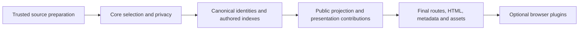

# Customize Gardener through Gitpa plugins

Gitpa should supply its podcast behavior through an optional plugin contract. Gardener should own standard Logseq publication and the host lifecycle. The first migration is the existing episode player: keep its playback logic, give it a persistent place in the shell, and notify it when a new page is adopted.

**Status: proposal and an unshipped, type-checked consumer experiment.** Gardener does not yet export the proposed API. The current production build and player are unchanged. [Gitpa93](https://github.com/codekiln/gitpa/issues/93) owns adaptation; [Gardener195](https://github.com/codekiln/logseq-gardener/issues/195) hands the reusable publisher and runtime work to the Claude agent.

## Gardener host proposal

[Gardener PR #255: plugin host for published sites](https://github.com/codekiln/logseq-gardener/pull/255) proposes the first runtime slice of this contract. Its manifest adds a plugin `version` and optional `pageProperties`; plugin IDs use lowercase letters, digits and hyphens. The publisher exposes only requested properties visible to readers. The host passes each plugin its own page metadata. The proposal also defines `lsg-site.json`, lower-cased page IDs, and a notice when a new build is encountered during navigation. Build-time presentation contributions remain a follow-up. The Gardener proposal remains under review.

## Keep these responsibilities separate

| Owner | Responsibility |
| --- | --- |
| Gardener core | Logseq parsing, selection/privacy, aliases, authored references, source anchors, transclusions, standard rendering, search, and shared page/fragment lifecycle. |
| Gardener extension host, implemented by Claude | Versioned manifests, public route identities, structured metadata/assets/slots, plugin lifecycle and disposal, compatibility checks, and performance validation. |
| Gitpa, implemented here | Episode interpretation, the persistent player, transcript/chapter enhancements beyond Logseq, homepage presentation, feed identity, palette, configuration and migration tests. |
| Source garden | Canonical episode text, verified transcripts and publication choices. |

Core behavior remains available with no plugins. A site explicitly enables its extensions; installing a plugin does not change what every other garden means by an ordinary Logseq page.

## What the current code teaches us

This inventory was checked at [Gitpa75cc8b83](https://github.com/codekiln/gitpa/tree/75cc8b8375b9467aa8f23fe3708180a7d444256a).

| Existing integration | Extension boundary needed |
| --- | --- |
| [Publication orchestration](https://github.com/codekiln/gitpa/blob/75cc8b8375b9467aa8f23fe3708180a7d444256a/scripts/build_site.py#L347) prepares a temporary graph, runs Gardener, then modifies its output. | Named publication phases with explicit inputs and outputs. |
| [Query insertion](https://github.com/codekiln/gitpa/blob/75cc8b8375b9467aa8f23fe3708180a7d444256a/scripts/build_site.py#L106) recognizes exact list/bullet HTML around a placeholder. | A presentation slot attached to a stable page/block identity. Derived rows stay outside authored-reference and search indexing. |
| [Player installation](https://github.com/codekiln/gitpa/blob/75cc8b8375b9467aa8f23fe3708180a7d444256a/scripts/build_site.py#L235) replaces `</head>` to add metadata and assets. | Structured per-page metadata and declared JS/CSS assets. |
| [Readable route packaging](https://github.com/codekiln/gitpa/blob/75cc8b8375b9467aa8f23fe3708180a7d444256a/scripts/build_site.py#L262) parses generated links and rewrites attributes. | Final routes supplied by the publisher before HTML and JSON emission. |
| [Page adoption](https://github.com/codekiln/gitpa/blob/75cc8b8375b9467aa8f23fe3708180a7d444256a/site/navigation.js#L190) calls individual shared globals and emits synthetic `hashchange`. | One documented host lifecycle; plugins subscribe to it without creating another router. |
| [Player ownership](https://github.com/codekiln/gitpa/blob/75cc8b8375b9467aa8f23fe3708180a7d444256a/site/player.js#L182) already separates a document-wide manager from each page's episode. | A site-lifetime plugin with page-adoption callbacks and a persistent shell region. |

The trusted selection policy in `scripts/prepare_site.py` runs before Gardener. It derives asset visibility from published episodes and edits only a temporary copy. Keep this earlier trust boundary while migrating presentation hooks; a late HTML plugin cannot reproduce it safely.

## Borrow lifecycle ideas from Logseq

The local Logseq0.10.6 source provides useful precedents: [`ready`](https://github.com/logseq/logseq/blob/0.10.6/libs/src/LSPlugin.user.ts#L532), [route hooks](https://github.com/logseq/logseq/blob/0.10.6/libs/src/LSPlugin.ts#L542), and [parent/child plugin connection](https://github.com/logseq/logseq/blob/0.10.6/libs/src/LSPlugin.caller.ts#L66). Its caller supports iframe and shadow arrangements. These are lifecycle and ownership references, rather than evidence that either transport is inherently slow.

Use TypeScript for an author-facing static-publication contract and compile plugins to ordinary ES modules. Runtime setup, subscriptions, structured contributions and explicit cleanup will feel familiar. Desktop editing, database access and the full Logseq plugin API are separate capabilities; this proposal does not promise binary or API compatibility with existing Logseq plugins.

Performance should come from doing publication work at build time, loading optional browser code when needed, and using direct calls for trusted in-page interactions. It must be measured against the current implementation. Same-realm JavaScript has the site's privileges; a TypeScript type or a capability name does not make it an untrusted-code sandbox.

## Build-time contributions

Give build extensions a read-only projection of selected, publishable originals after alias/privacy resolution. The projection must remove private or unresolved target identities, hidden metadata and source paths before crossing the API. TypeScript `readonly` describes the contract; the publisher must enforce the projection and validate returned data at runtime.

Presentation contributions should address public page/block ids and return structured content, declared assets and namespaced metadata. Resolve their links through the publisher's route table. Preserve canonical authored identities; generated query rows and copied UI do not create authored backlinks or search records. Page-property fields needed by an extension require an explicit publication policy, not access to every raw source property.

Start with a native Rust SDK boundary. A versioned process protocol can later admit TypeScript build tools: send one bounded publication/phase input, not a subprocess or JSON round trip for every block. The transport is an open implementation decision for Gardener195. Trusted build tools can access the filesystem outside this API, so the public projection is not a claim of process isolation.

The publisher should report duplicate plugin ids, unsupported major versions, malformed contributions, route/asset collisions and path escapes before committing output. Plugin order and output must be deterministic. Optional activation and canonical metadata must survive both hashed and readable routes; consumers should not infer either from display titles or CSS selectors.

## Browser lifecycle

The host owns initial loading and subsequent navigation. For each accepted navigation:

1. Prepare and validate the destination's public route, metadata and compatibility before replacing the current page. Reject superseded responses.
2. Abort the old page scope and run its cleanup. Keep site-owned regions, including the audio player, mounted.
3. Adopt the new page and metadata, then initialize shared core behavior through one host operation.
4. Notify plugins synchronously through `onPageAdopted`, with the new page scope. Core fragment reveal, zoom handling, focus and scrolling follow this phase.
5. Run optional work after paint or on demand. Async work uses the page signal and revision; a stale completion cannot modify a later page.

A plugin activates once per document. Repeated page adoption does not reload its module or construct another player. Site disposal removes its subscriptions and UI, and releases media resources. The host cleans up regions it allocated if setup fails. An optional plugin failure gets a local diagnostic and ordinary-link/native-media fallback; it does not take over core navigation.

Validate a manifest's API major and local asset URLs before import. Keep the plugin's version separate from the host API major. A newly deployed, incompatible page must offer recovery rather than silently reload a visitor's playing recording. Migration compatibility and diagnostics should be tested, not hidden behind a cast.

## The first consumer experiment

[`contracts/gardener-plugin.d.ts`](../contracts/gardener-plugin.d.ts) proposes the smallest host surface needed by the player. [`experiments/plugins/episode-player.ts`](../experiments/plugins/episode-player.ts) adapts the structural interface of the existing player manager. It does not implement a second host or ship a second navigation system.

The experiment creates the player on the first adoption, moves its existing footer into a persistent region, and reuses that manager on later pages. It accounts for the existing factory already displaying the initial page. Page-scope cancellation leaves the recording alive; site disposal pauses and releases it once. The contract deliberately rejects an async adoption callback: the host must not await plugin work before fragment focus.

Run `npm ci --ignore-scripts` and `node --test tests/plugin-contract.test.js`. This checks the TypeScript contract, negative compatibility/read-only examples, initial-adoption behavior, repeated page scopes, deferred footer creation and idempotent disposal. These are contract tests with a fake host. They do not prove browser playback or implement Gardener's extension runtime.

Before a production migration, extract the automatic bootstrap at the bottom of `site/player.js`. Importing that module today starts another navigator when a document exists. The shared host should load a side-effect-free player adapter, and the old bootstrap should remain the fallback until the shared runtime passes integration checks.

Retain the existing cancelable `lsg:media-seek` event and ordinary media links during this first migration. Claiming a seek must remain synchronous within the user gesture. Preserve original-anchor validation, copied-context isolation, explicit recording links and native fallback. The plugin owns episode/session policy; it does not redefine the meaning of a normal page reference.

## Migration and acceptance

- **Shared host, Claude:** implement Gardener195's versioned manifest, public route/metadata/assets boundary, persistent region and lifecycle; publish a tested contract/example. Resolve API differences with Gitpa93 before freezing them.
- **Player adaptation, Gitpa:** extract bootstrap side effects, use the shared host and metadata, and remove corresponding head rewriting and scattered initializer calls. Keep query and route rewrites until their own structured replacements exist.
- **Build contributions, both:** replace query-marker and route-parsing assumptions in focused follow-ups, preserving selected-source indexing and legacy destinations.

Measure an unchanged representative garden with zero plugins and the actual Gitpa site before and after migration. Zero plugins should request no plugin modules and preserve normal publication. Keep the existing startup and desktop/phone interaction budgets; compare transferred bytes, first-title work and cold/warm optional loading. Measure synchronous seek handling and repeated-navigation listener/heap behavior through the existing harness.

The browser acceptance route is episode → manual → another episode → Back, with search results, source fragments, zoom and theme changes along the way. Require one surviving advancing audio element, no duplicate handlers or playback restart, correct seek ownership, accessible desktop/mobile controls, stable routes, unchanged RSS identity and honest failure/retry behavior. Verify automatic production revision before calling the migration deployed.

Prepared disclosure/properties fixes remain in [Gardener181](https://github.com/codekiln/logseq-gardener/pull/181) and [Gardener183](https://github.com/codekiln/logseq-gardener/pull/183). Claude can review/reuse them; [Gitpa89](https://github.com/codekiln/gitpa/issues/89) owns their consumer adaptation. Their existence is separate from implementation of the plugin host.
